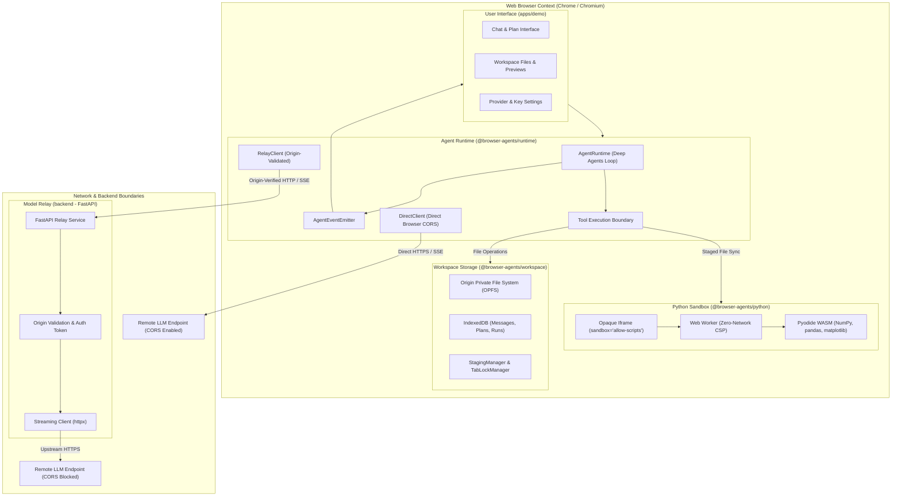
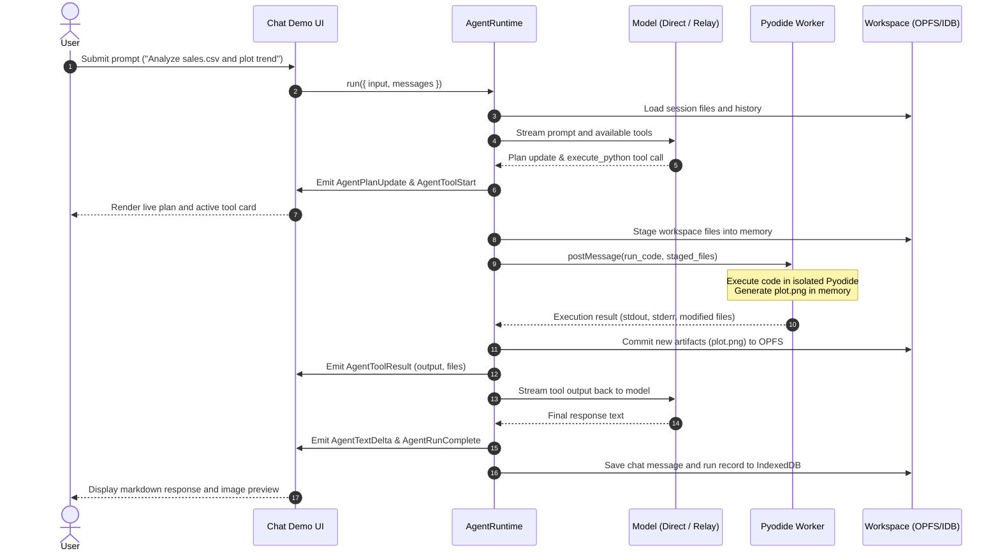

# Browser Agents

In-browser AI agent runtime and chat application where orchestration, multi-step planning, workspace file operations, and sandboxed Python data science run entirely client-side. Remote LLM connectivity connects directly from the browser or routes through an optional origin-verified local relay.

## Overview

Browser Agents executes the complete Deep Agents cognitive loop directly in the user's browser. Rather than relying on remote containers or server-side runners for tool execution, the client browser maintains planning state, coordinates tool calls, manages file artifacts, and executes Python data analysis locally using Pyodide WebAssembly.

Python runs inside a dedicated Web Worker nested within an opaque-origin sandbox iframe protected by a strict Content Security Policy (CSP). Model credentials remain strictly isolated from generated scripts and session exports. Storage relies on the Origin Private File System (OPFS) for files and IndexedDB for session history, providing persistent, offline-capable workspace state.

## Architecture Overview

The system is organized into a modular monorepo consisting of three client packages, a React demo application, and an optional FastAPI model relay.

- User Interface (`apps/demo`): React 19 single-page application built with Vite, Tailwind CSS, and Lucide icons. Renders conversational turns, live execution plans, tool call statuses, file previews, and rendered charts.
- Agent Runtime (`packages/runtime`): Implements `AgentRuntime`, Deep Agents browser adapter, LangChain chat model adapters (`OpenAIChatModel`, `RelayChatModel`, `ScriptedChatModel`), event bus, tool call dispatch, and step limits.
- Python Sandbox (`packages/python`): Implements `PythonSessionManagerImpl` and `PythonSessionImpl`. Hosts Pyodide in a zero-network Web Worker spawned from an opaque-origin iframe (`about:blank` with `sandbox="allow-scripts"`).
- Storage Layer (`packages/workspace`): Implements `WorkspaceManager` and `ChatWorkspace` using OPFS for binary and text files, IndexedDB for chat records, tab lock management via the Web Locks API, and staging diff calculations.
- Model Relay (`backend`): Optional FastAPI service handling origin verification, session management, and upstream model streaming for endpoints that restrict cross-origin browser requests.



## Key Features

- Client-side agent orchestration: LangChain and Deep Agents execution loop executes entirely within browser TypeScript, maintaining plan and task state.
- Sandboxed Python data analysis: Isolated Pyodide environment preloaded with NumPy, pandas, and matplotlib for data wrangling and chart generation.
- Zero network leakage: Python Web Worker runs under CSP `connect-src blob: data:`, blocking socket, HTTP, fetch, and credential access.
- Flexible model connectivity: Connect directly to OpenAI-compatible endpoints using browser fetch or route through the local relay when CORS is restricted.
- Persistent workspace storage: Origin Private File System (OPFS) stores files, while IndexedDB records conversational history, plans, and tool traces.
- Atomic file staging: Changes executed by Python scripts are staged, validated, and committed to storage atomically.
- Execution boundaries: Bounded step limits, execution timeouts, output truncations, and immediate cancellation of runaway loops.
- File staging and previewing: Upload local files, inspect CSV/JSON data, download generated artifacts, and view rendered Matplotlib plots directly in chat.

## Tech Stack

| Layer            | Technology                           | Details                                                    |
| ---------------- | ------------------------------------ | ---------------------------------------------------------- |
| Frontend UI      | React 19, TypeScript, Vite           | Tailwind CSS, Lucide React, Markdown and chart renderers   |
| Agent Runtime    | Deep Agents, LangChain, LangGraph    | Browser adapter, tool boundaries, streaming event emitters |
| Python Runtime   | Pyodide (WASM)                       | Python 3.12+ in Web Worker, NumPy, pandas, matplotlib      |
| Storage Layer    | OPFS & IndexedDB                     | Web Locks API, Web Crypto API (SHA-256), atomic staging    |
| Optional Relay   | Python 3.11+, FastAPI, Uvicorn       | Pydantic v2, HTTPX streaming, origin verification          |
| Monorepo & Build | pnpm workspaces, TypeScript          | Project references (`tsc -b`), Docker Compose, Makefile    |
| Test Frameworks  | Playwright, Node Test Runner, Pytest | End-to-end browser tests, unit suites, Black formatter     |

## Project Structure

```text
.
├── apps/
│   └── demo/                    # React 19 + Vite browser application
│       ├── src/
│       │   ├── components/      # Conversation, composer, files, modals
│       │   ├── lib/             # Preferences, sanitization helpers
│       │   ├── App.tsx          # Main chat application controller
│       │   └── main.tsx         # Application entry point
│       └── test/                # Playwright and workflow test suites
├── backend/                     # Optional FastAPI model relay service
│   ├── src/
│   │   └── relay/               # Origin validation, session store, upstream client
│   ├── tests/                   # Pytest test suite
│   └── pyproject.toml           # Python package specification
├── packages/
│   ├── python/                  # Sandboxed Pyodide execution manager
│   │   ├── src/                 # Worker code, security filters, session manager
│   │   └── test/                # Protocol and browser isolation tests
│   ├── runtime/                 # Deep Agents browser runtime and model adapters
│   │   ├── src/                 # Direct client, relay client, model adapters, events
│   │   └── test/                # Runtime and node context tests
│   └── workspace/               # In-browser storage and file staging
│       ├── src/                 # OPFS file store, IndexedDB records, path validation
│       └── test/                # Storage, concurrency, and staging tests
├── docs/                        # Architecture decisions and validation reports
├── scripts/                     # Endpoint verification and utility scripts
├── Makefile                     # Developer workflow targets
└── pnpm-workspace.yaml          # Workspace package layout
```

## Logic Flows

The following sequence diagram illustrates an execution turn when a user requests data analysis requiring Python execution and workspace artifact generation:



## Security and Isolation Architecture

The browser runtime enforces multi-layered defense boundaries:

- Opaque frame isolation: Python executes inside a Web Worker spawned from an opaque-origin iframe (`sandbox="allow-scripts"`).
- Strict Content Security Policy: `default-src 'none'; script-src 'unsafe-eval' blob:; connect-src blob: data:`. Network requests from Python or Worker JavaScript are blocked by the browser engine.
- Credential boundary: API keys remain in memory by default. If the user opts into browser storage, keys are stored in `localStorage` under the origin and never injected into prompts, chat logs, or the Python sandbox.
- Path traversal protection: Virtual workspace file paths are strictly validated against directory traversal (`..`, absolute paths outside `/`, null bytes, and non-whitelisted characters).
- Origin validation: The optional FastAPI relay strictly validates the HTTP `Origin` header against configured trusted frontend origins and uses ephemeral session tokens.
- Output validation: File count, individual file sizes, and aggregate payloads returned from the sandbox are bounded by explicit byte limits before committing to OPFS.

## Installation and Setup

### Prerequisites

- Node.js 22 or newer
- pnpm 11 or newer
- Google Chrome or Chromium desktop browser (for OPFS and Web Worker isolation)
- Python 3.11+ and uv (required only if running the optional model relay)

### Installation

Install all monorepo dependencies:

```sh
make setup
```

To install the optional relay backend dependencies:

```sh
pnpm setup:relay
```

### Running Development Servers

Start the frontend development server on `http://127.0.0.1:5173`:

```sh
make dev
```

To run services in the background using managed PID files:

```sh
make start        # Start frontend demo in background
make status       # Inspect process status and PIDs
make stop         # Stop background processes
```

To run both the frontend and the optional model relay concurrently:

```sh
pnpm dev:with-relay
```

Or start the relay as a background daemon:

```sh
make start-relay
make logs-relay   # Tail relay server logs
```

### Quality and Testing

Execute the complete quality check suite (formatting check, TypeScript compilation, and all unit tests):

```sh
make check
```

Or run targeted test suites independently:

```sh
make typecheck            # Run TypeScript compiler checks across all packages
make format-check         # Verify Python formatting with black
make test-workspace       # Run OPFS and IndexedDB storage tests
make test-python          # Run Python protocol and staging tests
make test-python-browser  # Run Playwright browser isolation tests
make test-runtime         # Run agent runtime test suite
make test-demo            # Run chat demo workflow test suite
make test-backend         # Run FastAPI relay pytest suite
```

### Production Build

Compile TypeScript packages and bundle the production Vite application:

```sh
make build
```

### Containerized Execution

Run the application stack using Docker Compose:

```sh
make docker-build
make docker-up                     # Launch frontend container
docker compose --profile relay up -d # Launch with optional relay service
make docker-down                   # Stop container stack
```

### GitHub Pages Deployment

The demo application is configured for automated deployment to GitHub Pages via GitHub Actions:

- Workflow: `.github/workflows/deploy-pages.yml`
- Triggers on push to `main` or manually via `workflow_dispatch`.
- Builds monorepo packages and static client assets into `apps/demo/dist`.
- Deploys static build artifacts via official GitHub Pages actions (`actions/configure-pages`, `actions/upload-pages-artifact`, `actions/deploy-pages`).

## Usage Examples

### Programmatic Agent Execution

Initialize an in-memory workspace and run an agent task using the direct client:

```ts
import { ChatWorkspace, MemoryFileStore, MemoryRecordStore } from '@browser-agents/workspace'
import { AgentRuntime, DirectClient, OpenAIChatModel, SessionPythonExecutor } from '@browser-agents/runtime'
import { PythonSessionManagerImpl } from '@browser-agents/python'

// Configure workspace storage
const workspace = new ChatWorkspace({
  chatId: 'session-01',
  files: new MemoryFileStore(),
  records: new MemoryRecordStore(),
})

// Configure direct model connection
const client = new DirectClient({
  baseUrl: 'https://api.openai.com/v1',
  apiKey: 'your-api-key',
})
const model = new OpenAIChatModel({ client, model: 'gpt-4o' })

// Configure sandboxed Python executor
const pythonManager = new PythonSessionManagerImpl()
const pythonSession = await pythonManager.getSession('session-01', { workspace })
const pythonExecutor = new SessionPythonExecutor(pythonSession)

// Instantiate and execute runtime
const runtime = new AgentRuntime({
  chatId: 'session-01',
  model,
  workspace,
  pythonExecutor,
})

const result = await runtime.run({
  input: 'Create a CSV file named data.csv containing 5 rows of random numbers, then calculate the mean.',
})

console.log('Agent status:', result.status)
console.log('Steps executed:', result.steps)
```

### Sandboxed Python Execution

Execute Python scripts directly inside the Web Worker sandbox:

```ts
import { PythonSessionManagerImpl } from '@browser-agents/python'

const manager = new PythonSessionManagerImpl()
const session = await manager.getSession('analysis-chat')

await session.initialize()

const result = await session.execute(`
import numpy as np
import pandas as pd

df = pd.DataFrame({
    'category': ['A', 'B', 'C', 'D'],
    'value': np.random.randn(4)
})
print("DataFrame summary:")
print(df.describe())
`)

console.log(result.stdout)
```

### Model Relay Configuration

When connecting to endpoints that do not support browser CORS, register the provider through the local relay:

```ts
import { RelayClient, RelayChatModel } from '@browser-agents/runtime'

const relay = new RelayClient('http://127.0.0.1:8765')
await relay.createSession()

const provider = await relay.registerProvider({
  baseUrl: 'https://restricted-endpoint.example.com/v1',
  apiKey: 'secret-key',
})

const model = new RelayChatModel({
  client: relay,
  providerId: provider.provider_id,
  model: 'meta-llama/Llama-3.3-70B-Instruct',
})
```

## Roadmap and Future Milestones

- WebGPU local inference: Pluggable browser LLMs without contacting external model endpoints.
- Subagents: Multi-agent coordination with hierarchical task execution.
- Dynamic package wheels: Support for loading additional pure-Python wheels at runtime.
